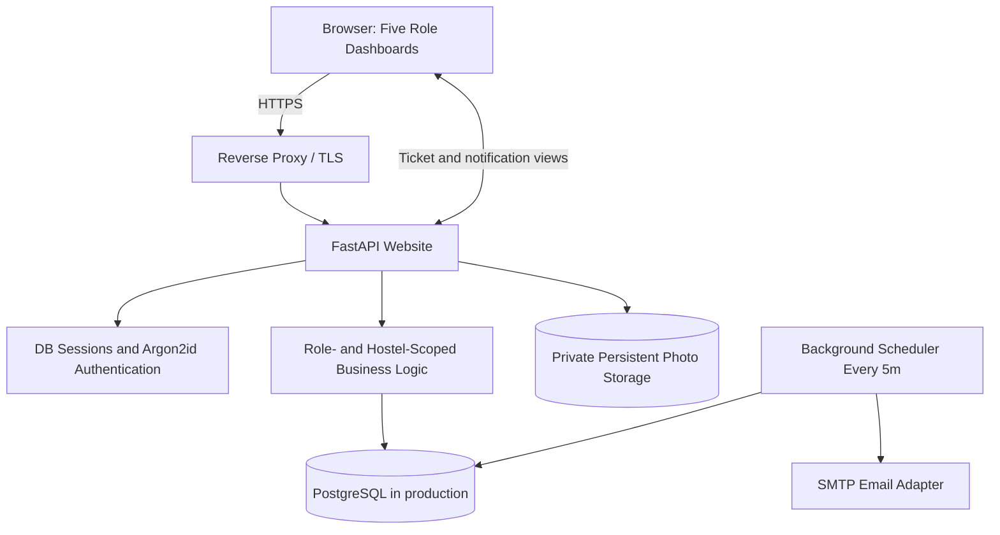
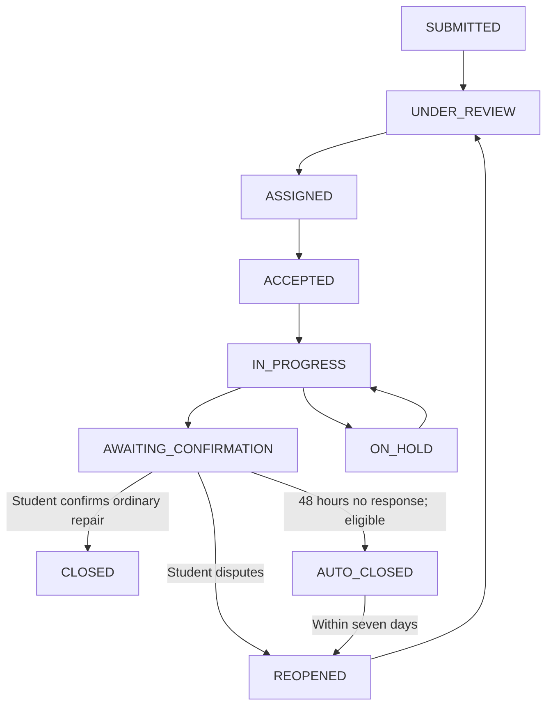

# Deployed System Architecture — HostelCare

This is the architecture implemented in this repository, which replaces the earlier Node/Nest and Supabase proposals with a standalone FastAPI application. It is a browser-based website only.

## Five-role boundary

- STUDENT — URN-based own-record access; room populated from active assignment.
- RECTOR — all scoped hostel complaints; assign/reassign and classification.
- MAINTENANCE_STAFF — only assigned complaint work and notes/photos.
- DEAN — escalations scoped to institution-approved hostels; directives, not repairs.
- SYSTEM_ADMIN — institution hostels/rooms/users and scopes; no ordinary complaint-content access.

## Complaint state workflow

## Non-interfering timers

1. No-start/Dean deadline is `work_cycle.started_at + 48h`. Reading, reviewing, assigning, or accepting does not stop this timer. Start of work AFTER the deadline still counts as overdue. Per-cycle unique escalation records are never discarded.
2. Post-repair student reminder is `work_completed_at + 24h`, auto-closure of *eligible ordinary cases* at +48h, and reopening for seven days after auto-closure.
3. The scheduler is a separate process. The website is not used as a timer. Losing the worker does not lose deadlines or database events; on restart it reconciles overdue work.

## Security/durability boundaries

- Mandatory first-login password update for accounts provisioned by Admin with one-time unique temporary passwords.
- Sessions are opaque database-backed token hashes; server controls URN, role and hostel-room assignment.
- CSRF anti-forgery form tokens, secure cookies and HTTP security headers; production HTTPS required.
- Photographs stored in a non-public directory and served only after authorization.
- PostgreSQL authoritative data; backups, migrations and alerting must be implemented and reviewed for college use.
